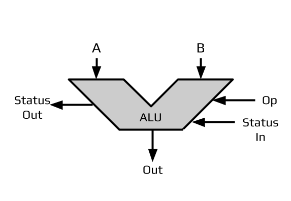
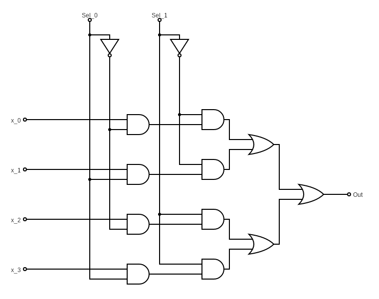
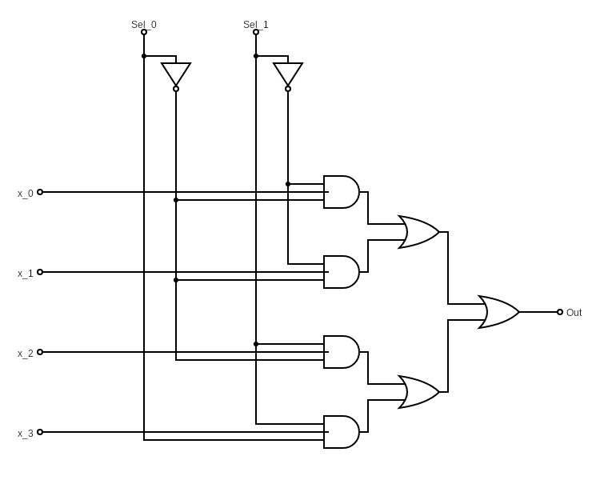
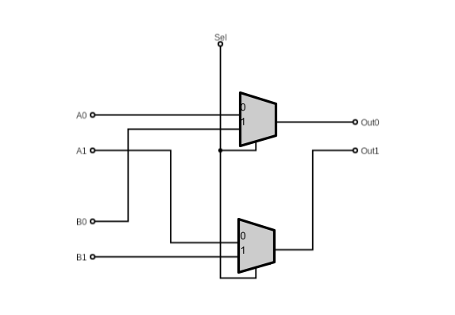
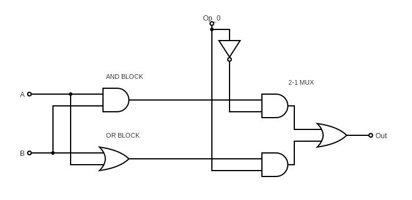

<<<<<<< HEAD
# Circuits 2: MUX and ALU

To make a CPU fully work, we need more than just the circuits that do the basic operations that we want; AND, OR, adding, etc. We also need a method of conditionally choosing which operation's result we want on the output. This is the job of the Arithmetic and Logic Unit (ALU) in the CPU; it takes in two operand numbers and an operation signal in order to output the result of one operation built into it.

## ALU Specs

The Arithmetic and Logic Unit (ALU) is the part of the CPU that is responsible for computing the result of the simple math and logical operations like adding, AND-ing, and others. The ALU above has the following properties:

- **Inputs**
	- A and B - the binary number operands for the intended operation
	- Op - the signal that selects what operation will be sent to Out
	- Status In - one or more signals that alter the operations within the ALU, for example whether addition should start with a carry bit
- **Outputs**
	- Out - The result of the selected operation on A and B
	- Status Out - Any status changes after the operation that will be processed elsewhere, for example whether addition resulted in an overflow or not

To describe an ALU, we care about two defining aspects: the **bit length** and the **operations**. The bit length refers to the bit length of the operands A and B as well as the output, Out. The number and types of operations that the ALU has access to is integral for defining the design of the circuit as well. Before defining anything after that, it must be decided what operations the ALU will be able to do. The number of operations defines how many bits we need for the operation signal as well as the entire layout of the finalized ALU. For every $2^n$ operations you need $n$ bits to select from them. Each bit pattern is assigned an operation that the ALU will parse using a Multiplexer.

In the above, if we were to read the diagram directly, it would be a 1-bit, 2-operation ALU since there are single-bit inputs and output, as well as 1-bit operation signal. With a single-bit, the signal can either be 0 or 1 and we can map both to an operation:

| Op  | Out         |
| --- | ----------- |
| 0   | Operation 0 |
| 1   | Operation 1 |

Later we will implement the following op-code table in the demonstration ALU:

| Op  | Out            |
| --- | -------------- |
| 0   | Out <- A AND B |
| 1   | Out <- A OR B  |

Chip designers aim to reduce signal propagation delay as much as possible and strive to make everything happen in parallel when power is supplied, changing functionality based on signals as they are that moment. This translates to the ALU calculating every operation available and selecting from one of the results to connect to out. This allows there to always be a result on the output signal and when the operation signal changes the result is already there to be switched to. It looks like this if we use a component for the Multiplexer:

## Multiplexers (MUXs)

Multiplexers (MUXs) are circuits that output a single signal chosen from its inputs based on a selection value. As such MUXs are many-to-one circuits that takes in multiple inputs and selectively outputs one of their values based on the selection pattern. 

MUXs are defined by how many inputs they take in and must select from. Since the number of patterns available to a bit string of $n$ bits is $2^n$ (See Signed/Unsigned Lesson), the number of inputs is always a power of 2. For example, if one wanted to select from 5 possible inputs, they would need 3 selection bits to represent it fully since $2^2 = 4$ is insufficient. The resulting MUX would be able to select from $2^3 = 8$, but would only take advantage of the first 5 patterns. For this reason MUXs are usually designed to take in a power of 2 number of inputs and enough bits to cover it, expecting later designs to use the MUX to its fullest. 

### 2-1 MUX

The simplest MUX is the 2 to 1 MUX (2-1 MUX), which takes in two input signals and a single selection signal. When the signal is 0 it outputs the first input, when it is 1 it outputs the second input. This gives us the following truth table:

| A   | B   | Sel | Out |
| --- | --- | --- | --- |
| 0   | 0   | 0   | 0   |
| 0   | 0   | 1   | 0   |
| 0   | 1   | 0   | 0   |
| 0   | 1   | 1   | 1   |
| 1   | 0   | 0   | 1   |
| 1   | 0   | 1   | 0   |
| 1   | 1   | 0   | 1   |
| 1   | 1   | 1   | 1   |

We could simplify it further since when Sel=0 we output whatever the value of A is and when Sel=1 we output whatever the value of B is:

| Sel | Out |
| --- | --- |
| 0   | A   |
| 1   | B   |

With the truth tables set up we can tackle implementing it into a circuit using boolean expressions. 

Since we want A to be output when Sel=0, we need to invert it in order to use it in later gates. Using that we can AND NOT(Sel) with A to copy the value of A when Sel=0. This results in the following expression:
- Not(Sel) AND A

If we break this expression down and make a truth table we can see this:

| A   | Sel | Not(Sel) | Not(Sel) AND A |
| --- | --- | -------- | -------------- |
| 0   | 0   | 1        | 0 = A          |
| 0   | 1   | 0        | 0 = 0          |
| 1   | 0   | 1        | 1 = A          |
| 1   | 1   | 0        | 0 = 0          |

The same principle can be used for B's case, only there is no need to invert Sel as we want B to propagate when Sel=1:
- Sel AND B

| B   | Sel | Sel AND B |
| --- | --- | --------- |
| 0   | 0   | 0 = 0     |
| 0   | 1   | 0 = B     |
| 1   | 0   | 0 = 0     |
| 1   | 1   | 1 = B     |

Since Sel and Not(Sel) can never be 1 at the same time, this means that only one of the above expressions have the ability to result in true at any given moment. Using that knowledge, we can combine both expressions using an OR gate:
- "A" Side : Not(Sel) AND A
- "B" Side : Sel AND B
- Combined : (Not(Sel) AND A) OR (Sel AND B)

This gives the following circuit diagram::

### 4-1 MUX

We can also extend this to take in 4 inputs, requiring the addition of another Sel signal:

| Sel_1 | Sel_0 | Out |
| ----- | ----- | --- |
| 0     | 0     | X_0 |
| 0     | 1     | X_1 |
| 1     | 0     | X_2 |
| 1     | 1     | X_3 |

Like before, in order to plan the resulting circuit, we can make boolean expressions of each case, OR-ing their results together at the end. The rule of thumb here is that whenever an output case needs one or both of the selection signals to be 0, wrap that input in a NOT, AND-ing the rest together:

- X_0
	- NOT(Sel_1) AND NOT(Sel_0) AND X_0
- X_1
	- NOT(Sel_1) AND Sel_0 AND X_1
- X_2
	- Sel_1 AND NOT(Sel_0) AND X_2
- X_3
	- Sel_1 AND Sel_0 AND X_3
- Combined
	- (NOT(Sel_1) AND NOT(Sel_0) AND X_0) OR
	- (NOT(Sel_1) AND Sel_0 AND X_1) OR
	- (Sel_1 AND NOT(Sel_0) AND X_2) OR
	- (Sel_1 AND Sel_0 AND X_3)

Fully drawn out:

Using 3-terminal AND gates:

You can also construct larger MUXs from simpler ones. The following is a 4-1 MUX made using 2-1 MUXs.

This approach is used in real chip designs today in certain situations. If one counted, they would see that this takes fewer gates (excluding NOTs) than the method doing the full derivation of the 4-1 MUX. The reason why it is not used always and the construction of these "MUX Trees" must be limited is that for every layer of 2-1 MUXs used, there is a propagation delay in order for the information to transmit through each layer and gate.

### Expanding to More Bits

The MUXs above all operate on selecting a single-bit from the inputs. However, as we expand our circuits, we will need to select from a series of numbers rather than individual bits. 

The way to select from one of multiple possible input numbers, you apply a MUX to each positional bit of the input numbers. For example, the following is a 2-bit 2-1 MUX:

This pattern scales up to both more bits and more inputs:
- For more bits -> Add a MUX for each positional bit
- For more inputs -> Make each MUX take in more inputs to fit, adding selection signals as needed
## ALU Circuits

We will now expand on the original diagram to show the full 1-bit 2-Op ALU. 1-bit ALUs are called slices and they will be used to construct larger ALUs later. 
### 1-Bit 2-OP ALU Slice

| Op  | Out            |
| --- | -------------- |
| 0   | Out <- A AND B |
| 1   | Out <- A OR B  |

Recall that the goal of the ALU is to find all results of the defined operations and use the operation signal to select which result will be output. This becomes a matter of filling in the MUX fully:

### 1-Bit 4-OP ALU Slice

In order to add more operations, it becomes a matter of:
- Adding the functional blocks that execute the operation
- Implementing a large enough MUX to select from the outputs

Let's expand naturally to the next power of 2 for the number of operations and make a 4-op ALU. We will still be making this a single-bit slice that is meant to be cascaded together in order to be applied to larger numbers. The number of operations available across a larger ALU is determined by the number of operations built into the ALU bit slices.

| Op1 | Op0 | Out            |
| --- | --- | -------------- |
| 0   | 0   | Out <- A AND B |
| 0   | 1   | Out <- A OR B  |
| 1   | 0   | Out <- NOT(A)  |
| 1   | 1   | Out <- A + B   |

![[alu_1_4.png]]

In the diagram above, there are 4 distinct blocks of operation that is then fed into a 4-1 MUX circuit.

Take note of the Full Adder Block that is taking the AND result in order to do the full carry overflow check instead of having an additional AND gate like we have in the original lesson. This is a clear benefit of designing the ALU from the ground up rather than fully relying on composable blocks. Also take note that this block is taking in a C_in signal and outputting a C_out signal in order to do the full adder circuit completely and is able to pass it along to the next ALU block.  

### Expanding to More Bits

To expand to more bits on the input and output, the circuit is expanded by adding 1-bit ALU Slices for each input bit and then passing the same operation signals to each one. Each bit of the inputs is fed into each ALU in order to construct the output, bit-by-bit. For more information or an example, check the full adder block diagram from Circuits 1.
=======
# More Circuits: MUX's, Decoders, and Registers

>>>>>>> 20ac58f51154dc6c3f1dd22dca32d882ea5c832f
