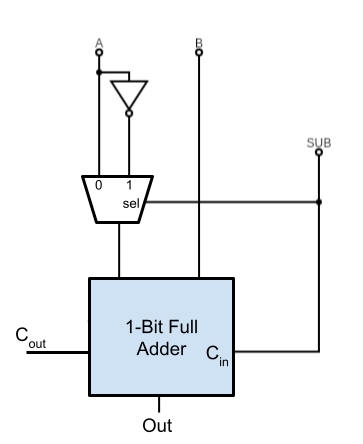
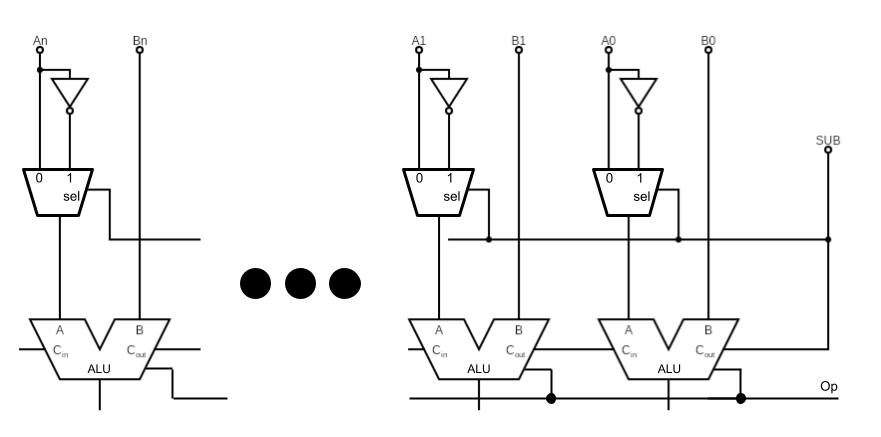

# Circuits 3: Subtractor, Shifters, Comparators, and Decoders

Knowing that the ALU is more of a structural idea rather than a definite circuit diagram that must be memorized allows us to now go into circuits that will expand the capabilities of the ALU. This lesson will go though subtraction, comparison, and bit shifting circuits that could be used as operations in a larger ALU. 

For this lesson we will be using a 1-bit ALU slice to construct a full ALU with additional functionality. For this purpose we will assume that the 1-bit ALU slice will represent a circuit with the following design:

## Adder/Subtractor Circuit

If we assume that the numbers within the computer will be signed using 2's Complement (See Signed Number Lesson), we can change the ripple carry adder/ALU design to allow for us to do both adding and subtracting using the same circuit by utilizing signed number properties.

When subtracting two numbers, $S = A - B$,  we can reframe the expression into addition: $S = A + (-B)$ . Showing that subtraction is addition with the subtrahend (amount being subtracted) being negated. 

In 2's Complement, in order to negate a number we follow $-B = NOT(B) +1$. If we combine this with the previous fact, we can convert the expression:
-  $S = A - B$
-  $S = A + (-B)$
- $S = A + NOT(B) + 1$

This becomes trivial to implement now since we have an adder circuit and the NOT gate. The $+ 1$
 is not a problem either as the full adder circuit contains a C_in on the first adder, allowing us to add 1 from the start. 

To implement it using our previous full adder circuit, we need a method of primitively choosing between $B$ and $NOT(B)$ based on if we want normal addition or subtraction. This can be achieved by a MUX with the truth table:

| SUB | Out    |
| --- | ------ |
| 0   | B      |
| 1   | NOT(B) |
The selection signal, SUB, will be a status that is sent from the CU to indicate when subtraction will be output rather than addition. That status will also be fed as the initial C_in for the ripple adder chain. This gives the following diagram:

These can be chained like the ripple adder circuits and the ALU slices, making them easy to integrate into your understanding of an ALU. 

## Comparison Bits

In order to do comparisons at the circuit level, we take advantage of the newly designed subtraction capabilities from the last section and add various status flags to our ALU setup.

Before going into the equality test, lets separate the SUB flag into two flags: 
- C_in : Carry in
- INVA : Invert A

We are doing this so that later on when we are deigning the CU, we can make the different operations use the flags independently without having them be tied together. Note that the circuit is still able to do subtraction, only now when subtraction is the intended operation the CU will send:
- Op = ADD
- C_in = 1
- INVA = 1

The first case of comparison that we will examine and implement will be when the two input values are equal to one another. When two integrers are equal to one another 

